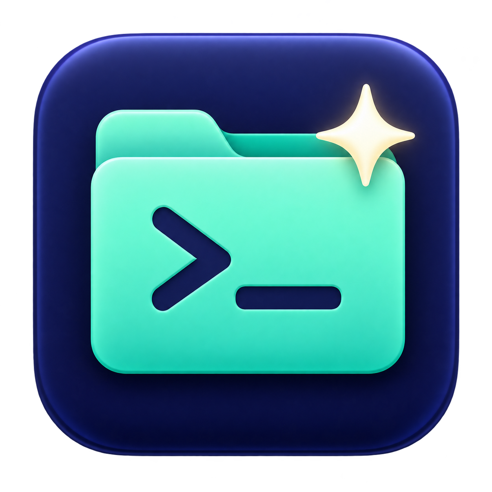

# AI Here



**Right-click any folder in macOS Finder to open it in Claude Code, Codex or WorkBuddy — CLI or desktop app.**
**在 macOS Finder 里右键文件夹，一键用 Claude Code / Codex / WorkBuddy 打开 —— 命令行版或桌面版都行。**

[English](#english) · [中文](#中文) · [Agent 接入 / For AI agents](#agent-接入--for-ai-agents)

跨 Codex、Claude Code、WorkBuddy 和 ChatGPT 的工作交接用法见 [工作交接指南](docs/cross-agent-handoff.md)。

---

## English

### Why

Before: select a folder → right-click "New Terminal at Folder" → type `claude` / `codex`. For the desktop apps it's even worse: copy the path, create a project, paste it in.

Now: **right-click the folder → Services → pick one.** Done.

### Install

```bash
git clone https://github.com/chenwenbo/ai-here.git
cd ai-here
./install.sh
ai-here doctor          # check what was found and installed
```

Requirements: macOS 13+ (tested on macOS 26), with [Claude Code](https://docs.claude.com/en/docs/claude-code) and/or [Codex CLI](https://github.com/openai/codex) installed. The desktop modes need the Claude / Codex / WorkBuddy desktop apps. No Xcode, no code signing — just shell, Automator and AppleScript.

### Three ways in

| When | Do |
|---|---|
| A folder is selected | Right-click → **Services** → `Claude Code CLI` / `Codex CLI` / `Claude Code App` / `Codex App` / `WorkBuddy` |
| You're already *inside* a folder (nothing selected) | Click the **AI Here** button in the Finder toolbar → pick a tool (also offers "continue last session") |
| In a terminal, or from an AI agent | `ai-here claude-cli .`, `ai-here codex-app ~/project`, `ai-here workbuddy ~/project`, … |

Menu labels: `CLI` = command-line tool, `App` = desktop app. The `WorkBuddy` item is only added when WorkBuddy is installed. To use English labels, edit the `ACTIONS` list at the top of `install.sh` (and the matching names in `uninstall.sh`), then re-run `./install.sh`.

To add the toolbar button, hold **⌘** and drag `~/Applications/AI Here.app` onto any Finder window's toolbar. You can also drop folders onto it.

The toolbar app has its own folder-and-terminal icon. Its chooser shows the corresponding Claude, Codex and WorkBuddy icons beside the seven launch actions, plus workspace handoff actions. Icons are copied from locally installed apps during installation; missing apps use macOS system symbols. Double-click an action to open it directly, or use arrow keys to select, Return to confirm, and Esc to cancel.

### Workspace handoffs

Pick **启用 / 修复工作交接** (Enable / repair handoff) in the toolbar chooser, or run:

```bash
ai-here handoff init ~/project --instructions
```

This creates `.ai-here/index.md`, a handoff template and a record folder. `--instructions` appends a small managed block to `AGENTS.md` and `CLAUDE.md`, preserving existing instructions. It asks the agent to read relevant records at the start and write a brief, evidence-based handoff at the end. Add `--ignore` to keep `.ai-here/` out of Git in private projects. Handoff commands require Python 3.9+ and no third-party packages.

Once enabled, the chooser offers **查看工作交接** (View handoff) and **复制交接摘要 · 用于 ChatGPT 等** (Copy summary for ChatGPT). WorkBuddy's pre-filled prompt points to the index; CLI sessions show a reading reminder. For ordinary ChatGPT conversations, paste the copied summary; a local Work session can read the same workspace files when access is granted. Closing an app does not capture or synchronize its conversation history.

See the [handoff guide](docs/cross-agent-handoff.md) for record creation, editing, privacy and tool boundaries.

### What each mode does

| Mode | How |
|---|---|
| `claude-cli` / `codex-cli` | Opens a new iTerm window (falls back to Terminal.app) and runs `cd <folder> && claude` (or `codex`) in your interactive shell, so your PATH and aliases work as usual |
| `claude-continue` / `codex-resume` | `claude --continue` / `codex resume --last` |
| `claude-app` | Opens `claude://code/new?folder=<folder>`, which starts a new session in the Claude desktop app's Code tab, rooted at that folder |
| `codex-app` | Runs `codex app <folder>`, which opens the folder as a workspace in the Codex desktop app |
| `workbuddy` | Opens `workbuddy://task?action=start&cwd=<folder>&prompt=…`: WorkBuddy starts a new task with that folder as its working directory. The prompt is only pre-filled, never sent |

Selecting several folders opens one session each. If a file is selected, its parent folder is used.

### Configuration

`~/.config/ai-here/config` (changes apply immediately):

```sh
TERMINAL_APP=auto      # auto | iTerm | Terminal
OPEN_IN=window         # window | tab (iTerm only)
CLAUDE_CMD="claude"    # e.g. "claude --model opus"
CODEX_CMD="codex"
WORKBUDDY_PROMPT="我们在「%s」这个文件夹里工作，先帮我看看里面有什么。"   # %s = folder name
WORKBUDDY_MODE=""      # code | work | design (empty = WorkBuddy decides)
HANDOFF_HINTS=1        # reading reminders for enabled workspaces
```

### Keyboard shortcuts (optional)

System Settings → Keyboard → Keyboard Shortcuts → Services → Files and Folders. Assign a shortcut to e.g. `Claude Code CLI`, then select a folder and press it.

### Update / uninstall

```bash
git pull && ./install.sh   # update
./uninstall.sh             # uninstall; add --purge to also delete the config
```

Installed to: `~/Library/Services/*.workflow`, `~/Library/Application Support/AIHere/ai-here`, `~/Applications/AI Here.app`, `~/.local/bin/ai-here`. Log: `~/Library/Logs/ai-here.log`.

### Troubleshooting

- **Codex is installed but Finder cannot find `codex`**: AI Here also checks the CLI bundled inside the installed Codex desktop app. CLI modes preserve your terminal's `codex` command and configured arguments, and use the bundled executable when it is absent from PATH.
- **The menu items don't show up**: System Settings → Privacy & Security → Extensions → Finder, and enable them. Or run `killall Finder`.
- **"… wants to control iTerm/Terminal" on first use**: click Allow. If you clicked Don't Allow, re-enable it under System Settings → Privacy & Security → Automation.
- **Two Claude desktop entries in the menu**: recent Claude desktop versions ship their own `New Claude Code Session Here`, which does the same thing. Turn one of them off under System Settings → Keyboard → Keyboard Shortcuts → Services.

---

## 中文

### 为什么做这个

以前：选中文件夹 → 右键用终端打开 → 输入 `claude` / `codex`；桌面版更麻烦，要复制路径、新建项目、再粘贴进去。

现在：**右键文件夹 → 服务 → 选一个**，完事。

### 安装

```bash
git clone https://github.com/chenwenbo/ai-here.git
cd ai-here
./install.sh
ai-here doctor          # 查看检测到的工具和已安装的右键菜单
```

依赖：macOS 13+（在 macOS 26 上测试），已安装 [Claude Code](https://docs.claude.com/en/docs/claude-code) 和/或 [Codex CLI](https://github.com/openai/codex)；桌面版模式需要对应的 Claude / Codex / WorkBuddy 桌面应用。无需 Xcode、无需签名，纯 shell + Automator + AppleScript。

### 三个入口

| 场景 | 操作 |
|---|---|
| 选中了某个文件夹 | 右键 → **服务** → `Claude Code CLI` / `Codex CLI` / `Claude Code App` / `Codex App` / `WorkBuddy` |
| 已经在某个文件夹里面（没选中任何东西） | 点 Finder 工具栏上的 **AI Here** 按钮 → 选择工具（也提供“继续上次会话”） |
| 在终端里，或让 AI Agent 调用 | `ai-here claude-cli .`、`ai-here codex-app ~/项目`、`ai-here workbuddy ~/项目` 等 |

`WorkBuddy` 菜单项只在检测到已安装 WorkBuddy 时才会添加。工具栏按钮的安装：按住 **⌘** 把 `~/Applications/AI Here.app` 拖到任意 Finder 窗口的工具栏上。也可以把文件夹直接拖到这个按钮上。

工具栏应用使用独立的「文件夹 + 终端 + AI 星芒」图标。七个启动选项都有对应的 Claude、Codex 或 WorkBuddy 图标，并提供工作交接入口。安装时从本机应用读取图标；未安装的工具使用 macOS 系统图标。双击选项即可执行，也支持方向键选择、回车确认及 Esc 取消。

### 跨 Agent 工作交接

点工具栏的 **启用 / 修复工作交接**，或者运行：

```bash
ai-here handoff init ~/项目 --instructions
```

系统会创建 `.ai-here/index.md`、交接模板与记录目录。`--instructions` 在保留原有内容的前提下，给 `AGENTS.md`、`CLAUDE.md` 追加简短入口：让 Agent 开始时阅读相关交接，结束前写入已完成事项、证据与下一步。私密项目可加 `--ignore` 将 `.ai-here/` 排除在 Git 之外。交接命令需要 Python 3.9+，无需安装第三方包。

启用后，工具栏提供 **查看工作交接** 和 **复制交接摘要 · 用于 ChatGPT 等**。WorkBuddy 的预填提示词会带读取路径，CLI 会显示交接提醒。普通 ChatGPT 对话粘贴摘要即可；有本地目录权限的 Work 会话可读取同一份文件。关掉软件不会自动采集或同步聊天历史，当前 Agent 需在任务结束前写交接。

写入、编辑、刷新和各工具的接入边界见[工作交接指南](docs/cross-agent-handoff.md)。

### 各模式做了什么

| 模式 | 实现 |
|---|---|
| `claude-cli` / `codex-cli` | 在 iTerm（没有则用系统终端）新窗口里 `cd <目录> && claude`（或 `codex`），走你的交互式 shell，PATH/别名与平时一致 |
| `claude-continue` / `codex-resume` | `claude --continue` / `codex resume --last` |
| `claude-app` | 打开 `claude://code/new?folder=<目录>`，Claude 桌面版的 Code 标签页直接以该目录新建会话 |
| `codex-app` | 执行 `codex app <目录>`，Codex 桌面版直接打开该工作区 |
| `workbuddy` | 打开 `workbuddy://task?action=start&cwd=<目录>&prompt=…`，WorkBuddy 以该文件夹为工作目录新建任务；提示词只预填、不会自动发送 |

选中多个文件夹时会各开一个；选中的是文件则使用其所在文件夹。

### 配置

`~/.config/ai-here/config`（改完立即生效）：

```sh
TERMINAL_APP=auto      # auto | iTerm | Terminal
OPEN_IN=window         # window | tab（仅 iTerm）
CLAUDE_CMD="claude"    # 例如 "claude --model opus"
CODEX_CMD="codex"
WORKBUDDY_PROMPT="我们在「%s」这个文件夹里工作，先帮我看看里面有什么。"   # %s = 文件夹名
WORKBUDDY_MODE=""      # code | work | design（留空由 WorkBuddy 决定）
HANDOFF_HINTS=1        # 已启用交接的工作空间显示读取提醒
```

### 键盘快捷键（可选）

系统设置 → 键盘 → 键盘快捷键 → 服务 → 文件和文件夹，给 `Claude Code CLI` 等设置快捷键，之后选中文件夹按快捷键即可。

### 更新 / 卸载

```bash
git pull && ./install.sh   # 更新
./uninstall.sh             # 卸载，加 --purge 同时删除配置
```

安装位置：`~/Library/Services/*.workflow`、`~/Library/Application Support/AIHere/ai-here`、`~/Applications/AI Here.app`、`~/.local/bin/ai-here`。日志：`~/Library/Logs/ai-here.log`。

### 常见问题

- **已安装 Codex，但 Finder 找不到 `codex` 命令**：AI Here 会自动查找 Codex 桌面应用内置的 CLI。终端模式优先保留原有 `codex` 命令及配置参数，PATH 中没有命令时使用应用内置的可执行文件。
- **右键菜单里没出现**：系统设置 → 隐私与安全性 → 扩展 → 访达（Finder）里勾选；或执行 `killall Finder`。
- **第一次使用弹出“想要控制 iTerm/终端”**：点“允许”。如果误点了拒绝：系统设置 → 隐私与安全性 → 自动化 中重新勾选。
- **右键菜单有两个 Claude 桌面版入口**：较新版本的 Claude 桌面版自带 `New Claude Code Session Here`，功能相同，可在 系统设置 → 键盘 → 键盘快捷键 → 服务 中取消勾选其中一个。

---

## Agent 接入 / For AI agents

AI Here 不只给人用，也可以交给 Claude Code、Codex、WorkBuddy 这类 AI Agent 安装和调用。
AI Here is built to be installed and driven by AI agents (Claude Code, Codex, WorkBuddy, …) too.

### 1. 让 Agent 帮你安装 / Let your agent install it

把下面这段话直接发给你的 Agent / Paste this to your agent:

```text
请帮我安装 AI Here（https://github.com/chenwenbo/ai-here）：
1. 把仓库 clone 到 ~/ai-here（已存在就 git pull）
2. 在仓库目录运行 ./install.sh
3. 运行 ai-here doctor，告诉我检测到了哪些工具、右键菜单里装了哪些选项
4. 提醒我：第一次使用时 macOS 会询问是否允许控制 iTerm/终端，要点“允许”
```

### 2. 命令行接口 / CLI for agents

Agent 调用时用这几个命令就够了 / Everything an agent needs:

```bash
ai-here doctor --json                       # 机器可读的安装状态 / machine-readable status
ai-here <mode> <绝对路径/absolute path>      # 打开文件夹 / open a folder
AI_HERE_DRY_RUN=1 ai-here claude-app <path> # 只打印深链、不打开 / print the deep link only
ai-here handoff init <path> --instructions # 启用工作空间交接 / enable handoffs
ai-here handoff add <path> --title "任务标题" --agent codex --status completed --body-file -
ai-here handoff list <path>                # 查看记录 / list records
ai-here handoff export <path>              # 输出摘要 / export summary
```

`doctor --json` 示例 / example:

```json
{"version":"1.3.1","claude_cli":"/Users/you/.local/bin/claude","codex_cli":"/Users/you/.local/bin/codex",
 "claude_app":"/Applications/Claude.app","codex_app":"/Applications/Codex.app","workbuddy_app":"/Applications/WorkBuddy.app",
 "terminal":"iTerm","config":"/Users/you/.config/ai-here/config","handoff_runtime":"/usr/bin/python3","services":["Claude Code CLI","…","WorkBuddy"]}
```

字段为空字符串表示没找到该工具。模式列表同上文：`claude-cli`、`claude-continue`、`codex-cli`、`codex-resume`、`claude-app`、`codex-app`、`workbuddy`。
An empty string means the tool was not found. Modes are listed above.

约定 / Conventions:

- 传绝对路径；传文件会自动用它所在的文件夹 / Pass absolute paths; a file resolves to its folder.
- 这些命令会在用户屏幕上打开窗口，只在用户要求时调用 / These open windows on the user's screen; only run them when asked.
- 退出码 0 表示已发出打开请求；出错时会写日志并弹 macOS 通知 / Exit code 0 means the open request was sent; errors go to the log and a macOS notification.

---

## Project layout / 项目结构

```
bin/ai-here               Core launcher; every entry point calls it  核心启动脚本（所有入口最终都调用它）
src/AIHere.applescript    Finder toolbar button (compiled to AI Here.app)  Finder 工具栏按钮
src/AIHere.icns           App icon (all macOS sizes)  应用图标
src/AIHere.png            App icon source / preview  应用图标原图
src/export-tool-icons.js  Copies locally installed tool icons into the app  提取本机工具图标
lib/handoff.py            Workspace handoff records, index and exports  工作交接管理
tests/                    Handoff and launcher integration checks  交接与启动器测试
install.sh                Generates the Finder services, toolbar app and CLI  安装
uninstall.sh              Uninstaller  卸载
config.example            Config template  配置模板
```

## License

MIT
